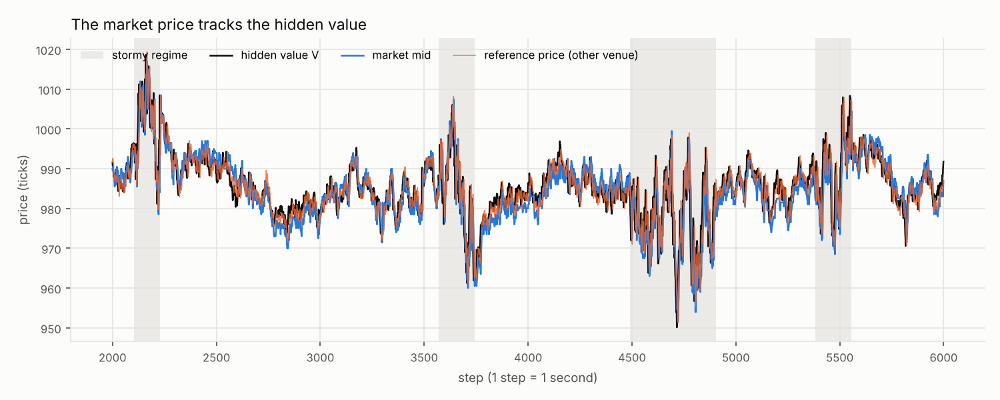
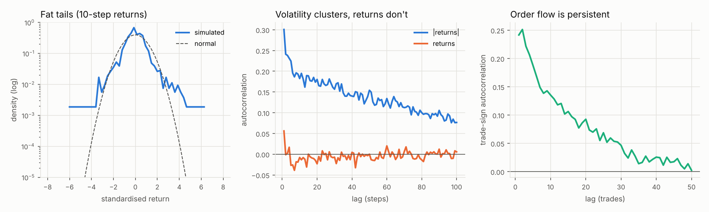
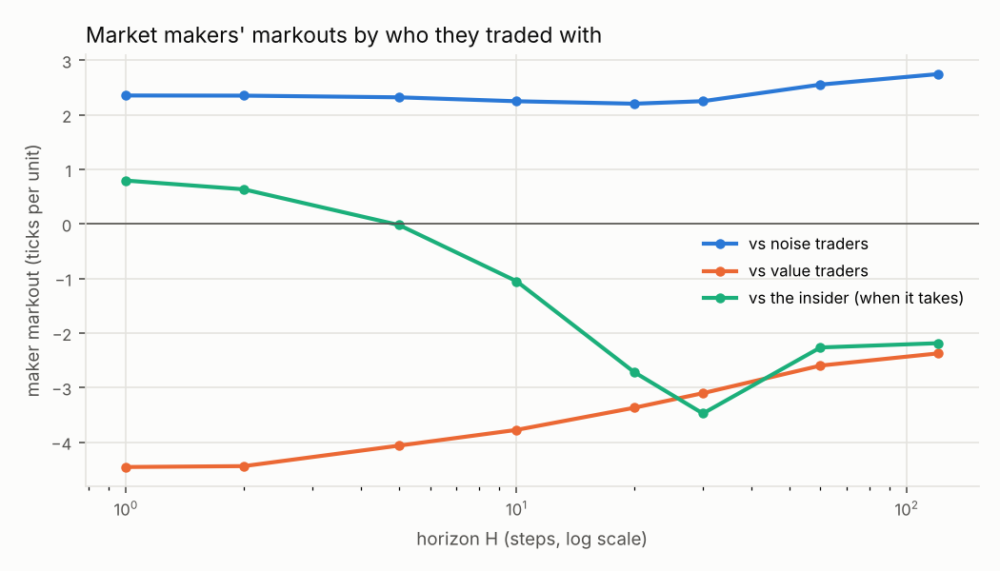

# mm-sim: a market-making simulator

A dealer-market simulator for studying how market makers lose to better-informed
traders and which quoting strategies limit that loss.

A hidden true value V drives the market but is never visible to market makers.
The public price is formed by competing market makers' quotes, which react to
order flow and to a lagged, noisy reference price (another venue). V is used
only for evaluation: markouts, tracking error and PnL.

> Findings: to be written.

## Run it

```bash
source .venv/bin/activate
pytest -q                                   # invariants and unit tests
python -m experiments.validate_market       # realism report + figures/ (about 1 minute)
```

## Layout

| Path | What it is |
| --- | --- |
| `sim/price.py` | Hidden value V (mean reversion to a drifting anchor, calm/stormy regimes, jumps), oracle R², reference feed |
| `sim/market.py` | Quote book for one step: matching rules, tie-breaks, post-only |
| `sim/engine.py` | Simulation loop, recorded prices, inventories, cash |
| `sim/accounting.py` | Ledger with fees and rebates; cash and inventory are conserved |
| `sim/metrics.py` | Stylised facts, markouts, impact, PnL by participant |
| `sim/scenarios.py` | Default population and a one-call `run(seed)` |
| `bots/` | Naive, Avellaneda–Stoikov, flow-reactive and insider market makers; noise, value and momentum traders |
| `experiments/validate_market.py` | Checks the market against properties of real markets |
| `tests/` | Conservation, determinism, matching rules |

## Realism checks

`experiments/validate_market.py` runs the default market over 20 seeds and tests
it against known properties of real markets:




